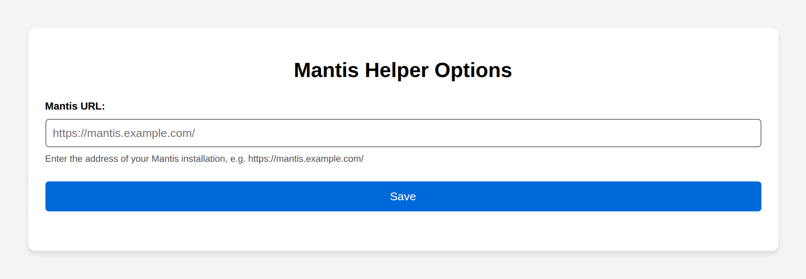
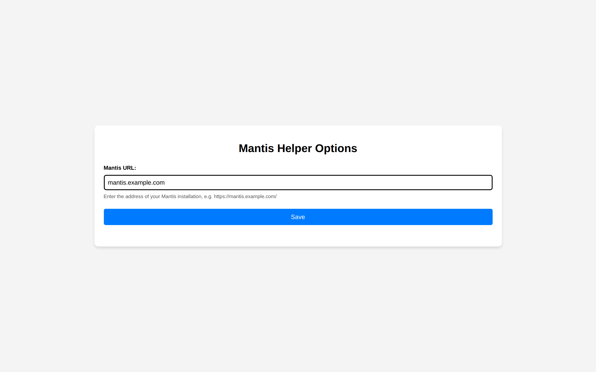
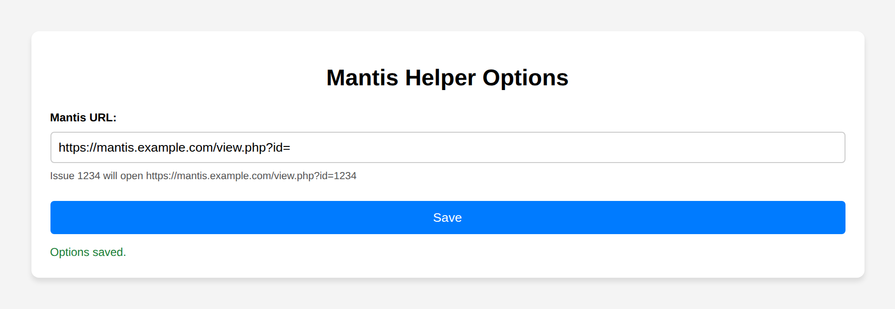
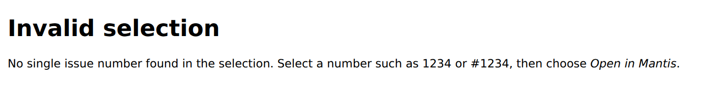

# Screenshots

Every page the extension shows, taken by the docs tour (`e2e/docs/tour.spec.ts`) in headless
Chromium with a fictional Mantis address. Regenerate them with `scripts/docs-screenshots.sh`
(see the main [README](../../README.md#screenshots)).

The context menu entry **Open “…” in Mantis** is part of the browser's own menu, which no
screenshot of a page can show.

## Options: not configured yet

A fresh install: the field is empty and the line below it says what to enter.

## Options: unusable URL

An address without `http://` or `https://` is rejected: the hint stays, and **Save** does not save it.

## Options: saved

After **Save**, the base address has become the issue URL prefix, and the line below shows which
address issue 1234 will open.

## Invalid selection

Opens in a new tab when the selection holds no issue number, or several that are equally likely
(here: “Issues 12 and 34”).

